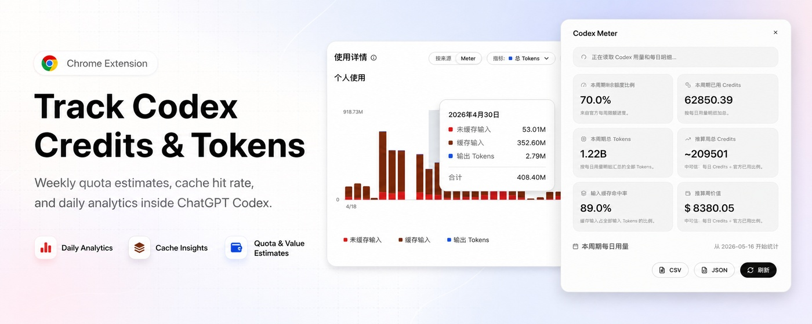
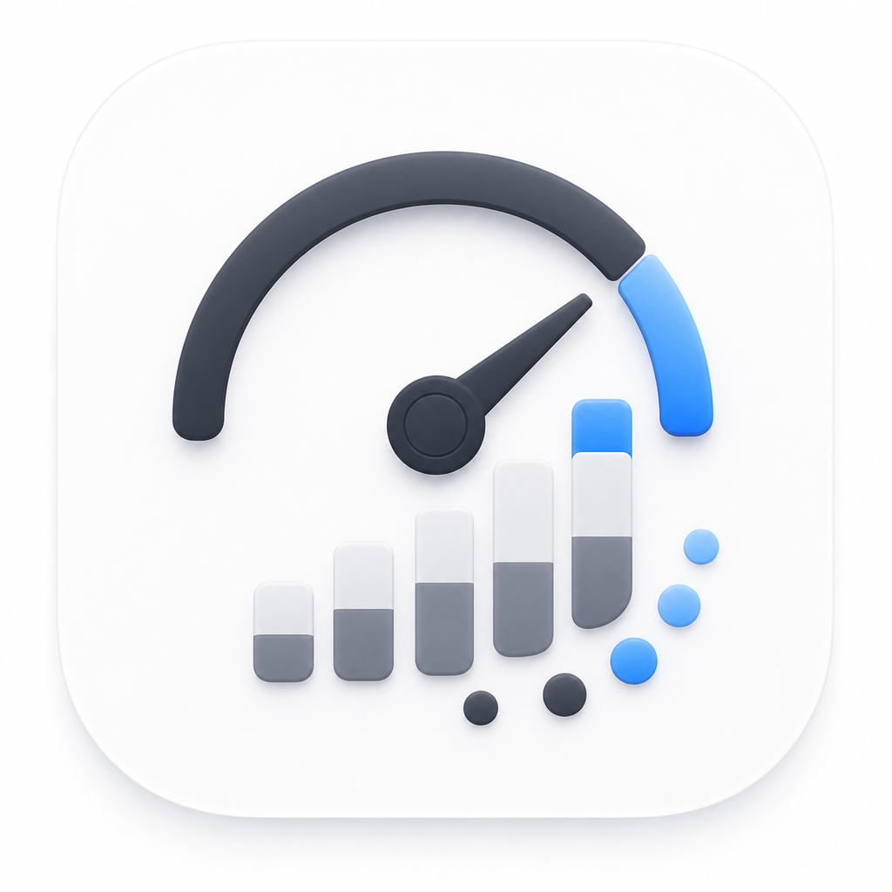
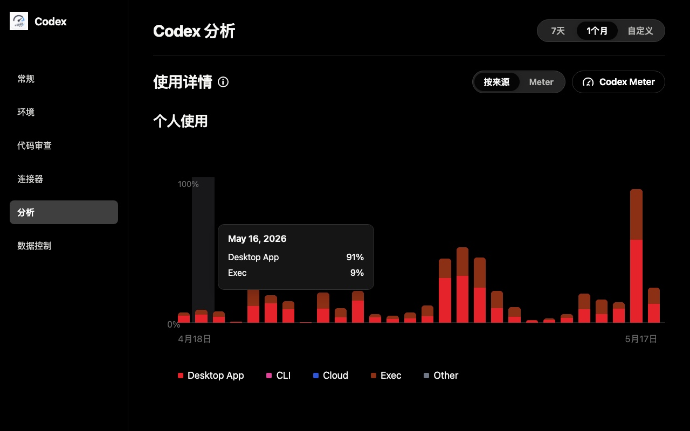
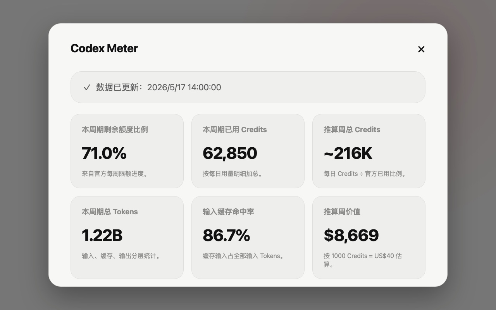
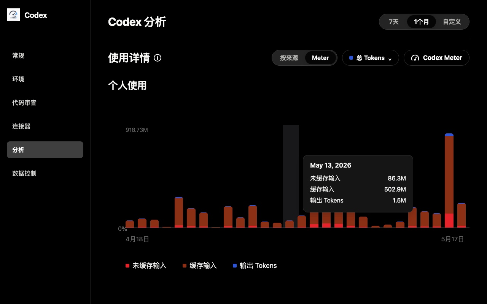
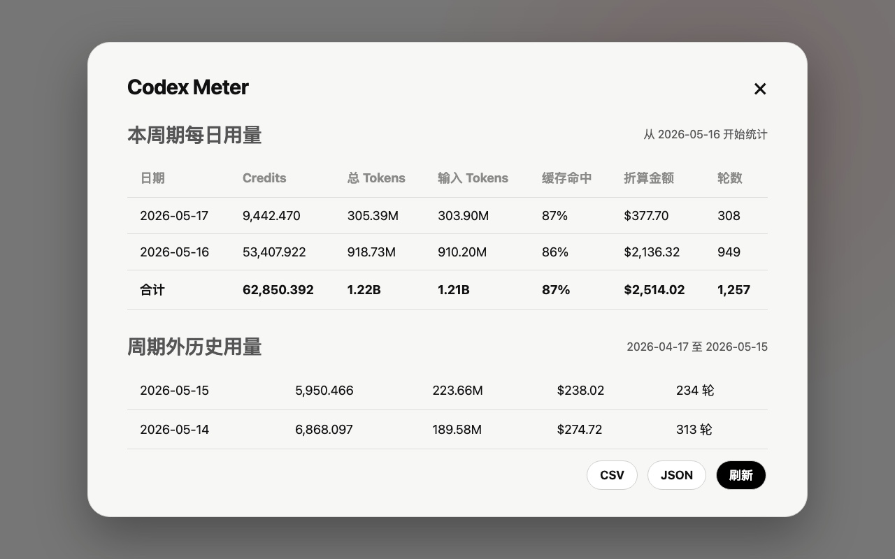

<p align="center">
  
</p>

<p align="center">
  
</p>

<h1 align="center">Codex Meter</h1>

<p align="center">
  Local Work and Codex quota, Credits, and token analytics inside ChatGPT.
</p>

<p align="center">
  <a href="https://github.com/Wangnov/codex-meter/blob/main/LICENSE"></a>
  <a href="https://github.com/Wangnov/codex-meter"></a>
  <a href="https://chatgpt.com/settings/usage?tab=analytics"></a>
</p>

<p align="center">
  <a href="#readme-cn">中文</a> · <a href="#readme-en">English</a>
</p>

## Screenshots / 截图

<p align="center">
  
  
</p>

<p align="center">
  
  
</p>

---

<a id="readme-cn"></a>

# 中文

`Codex Meter` 是一个本地 Chrome 扩展，用来增强 ChatGPT 设置中的用量分析页。新版官方页面把 Work、Codex 等用量放在同一个「用量历史记录」区域；扩展会在该区域加入入口按钮和图表控制器，并用适配当前 ChatGPT 主题的页面内弹窗展示本周期 Credits、Tokens、缓存命中率、推算周额度、折算金额和每日明细。浏览器扩展弹窗作为管理面板，用来控制页面内按钮、图表入口、默认图表模式和本地快照。

它不需要额外登录，也不会保存 ChatGPT Web token。刷新数据时，它只在当前页面内读取 ChatGPT 页面已经持有的鉴权信息，并请求同源的 ChatGPT Web usage 接口。

## 适合谁用

- 你经常使用 Work 或 Codex，并想更清楚地看 Credits 和 Tokens 消耗
- 你希望把每日用量、周期内合计、历史区间放在一个更直观的弹窗里看
- 你希望工具跟随当前 ChatGPT 设置页主题，而不是额外开一个陌生 dashboard
- 你接受这是一个依赖 ChatGPT Web 私有接口的本地增强工具

## 功能

- 在 `https://chatgpt.com/settings/usage?tab=analytics` 的「用量历史记录」旁加入 `Codex Meter` 按钮
- 在「用量历史记录」图表卡片中加入 `官方 / Meter` 切换，支持 Credits、总 Tokens、折算金额、轮数等指标
- 浏览器扩展弹窗提供页面内按钮、图表控制和默认图表模式管理
- 从 ChatGPT 标签页打开扩展弹窗时，弹窗跟随该页面的当前主题；从其他页面打开时使用系统主题
- Meter 图表跟随新版页面的 7 天 / 30 天区间和前后时段切换
- 总 Tokens 图表按未缓存输入、缓存输入、输出 Tokens 分层展示
- 图例按官方样式展示当前区间或所选单日的占比，悬停明细展示实际用量；点击图例可隐藏或恢复系列，支持点击柱形、左右方向键、Home / End 和 Escape 选择日期或返回整段
- Tokens 可按组成或使用端分组，轮数支持按模型分组；Credits 与折算金额默认按使用端展示，仅在接口提供有效模型额度明细时开放按模型查看
- 使用当前 ChatGPT 设置页的表面、文字和边框颜色令牌，跟随浅色 / 深色主题
- 图表高度、柱宽、圆角、图例字号和控件尺寸对齐官方组件；指标、分组、系列和日期变化平滑过渡，并遵循减少动态效果设置
- 按页面 locale 自动切换文案，内置 `zh-CN`、`zh-TW`、`zh-HK`、`en-US`、`ja-JP`、`fr-FR`、`ru-RU`、`es-ES`、`de-DE`
- 统计本周期 Credits、总 Tokens、输入 Tokens、缓存命中率、推算周额度和折算金额
- 展示本周期每日明细和周期外历史明细
- 支持 JSON / CSV 导出
- 用 `chrome.storage.local` 保存紧凑的本地快照
- 使用本地内联 SVG 图标，不加载远程脚本

## 数据来源与范围

- `/backend-api/wham/usage` 提供当前套餐限额、已用比例和重置时间
- `/backend-api/wham/analytics/daily-workspace-usage-counts` 提供 Credits、轮数和未缓存输入、缓存输入、输出 Tokens 等绝对值；默认请求最近 45 天，用户向前翻看更早区间时，`start_date` 会自动扩展到当前显示区间的起始日期，`end_date` 始终使用排他上界；实际返回天数取决于账号已有记录
- 新版页面的 `/backend-api/wham/usage/daily-token-usage-breakdown?units=percent` 返回按功能、模型或使用端划分的百分比，只能用于占比展示，不会替代 Meter 中的绝对 Tokens 数据
- 原始日明细的 `clients` 包含 Tokens、Credits、轮数；`models` 不提供 Tokens，且模型 Credits 在部分账号中为零。未归类差额独立展示，占比不会因隐藏系列而改变；分组超过接口总计时会显示差异提示

## 安装

```bash
git clone https://github.com/Wangnov/codex-meter.git
```

然后在 Chrome 里：

1. 打开 `chrome://extensions`
2. 开启 `Developer mode`
3. 点击 `Load unpacked`
4. 选择 clone 下来的扩展目录：

```text
codex-meter/codex-meter-extension
```

## 使用

1. 打开 <https://chatgpt.com/settings/usage?tab=analytics>
2. 点击「用量历史记录」旁的 `Codex Meter`
3. 在页面内弹窗里刷新、查看明细，或导出 JSON / CSV；在浏览器扩展弹窗里管理显示开关和本地快照

## 隐私和限制

- 扩展不会保存 ChatGPT Web bearer token
- 用量快照只保存在本机 Chrome 的 `storage.local`
- 这个项目依赖 ChatGPT Web 的私有 `wham` analytics 接口；如果 OpenAI 调整页面结构或接口字段，扩展可能需要适配
- 本项目不是 OpenAI 官方项目，也不与 OpenAI 存在隶属关系

## 开发

这个扩展是 buildless 的 MV3 项目，核心目录在 `codex-meter-extension/`。

```bash
# JS 语法检查
find codex-meter-extension -name '*.js' -maxdepth 3 -print0 | xargs -0 -n1 node --check

# manifest 检查
node -e "JSON.parse(require('fs').readFileSync('codex-meter-extension/manifest.json','utf8'))"

# 本地打包
rm -f codex-meter-extension.zip
(cd codex-meter-extension && zip -r ../codex-meter-extension.zip .)
unzip -t codex-meter-extension.zip
```

发布到 Chrome Web Store 的 GitHub Actions 工作流会在两种情况下运行：

- 手动触发 `Publish Chrome Web Store`
- 发布非 prerelease 的 `v*` GitHub Release

自动发布会校验 release tag 是否匹配 `manifest.json` 版本号，并在上传前检查商店中没有待审核版本。

---

<a id="readme-en"></a>

# English

`Codex Meter` is a local Chrome extension for the usage analytics page in ChatGPT settings. The current page combines Work, Codex, and other usage in one Usage history area. The extension adds an entry button and chart controls there, plus an in-page modal styled with the current ChatGPT theme for cycle Credits, Tokens, cache hit rate, projected weekly Credits, estimated value, and daily usage rows. The browser extension popup controls the in-page button, chart controls, default chart mode, and local snapshots.

It does not require another login and does not store your ChatGPT Web token. When you refresh data, it reads the authentication already available on the current ChatGPT page and calls same-origin ChatGPT Web usage endpoints.

## Who this is for

- You use Work or Codex often and want a clearer view of Credits and token usage
- You want daily usage, cycle totals, and historical rows in one quick modal
- You prefer an enhancement that follows the current ChatGPT settings theme instead of a separate dashboard
- You are comfortable with a local tool that depends on private ChatGPT Web endpoints

## Features

- Adds a `Codex Meter` button beside Usage history on `https://chatgpt.com/settings/usage?tab=analytics`
- Adds an `Official / Meter` switch inside the Usage history chart card, with Credits, total Tokens, estimated USD value, and turns
- Provides an extension popup for managing in-page visibility, chart controls, and default chart mode
- When opened from a ChatGPT tab, the extension popup follows that page's current theme; on other pages it uses the system theme
- Follows the current page's 7-day / 30-day ranges and previous / next period controls
- Shows total Tokens as uncached input, cached input, and output token layers
- Matches the official legend presentation for period or day percentages, with absolute values in hover details; click a legend to hide or restore a series, and select dates with bars, arrow keys, Home / End, or Escape
- Groups Tokens by composition or client and turns by model; Credits and estimated value default to client breakdowns, with model grouping available only when the API supplies valid model credit details
- Uses the current ChatGPT settings surface, text, and border color tokens and follows light / dark theme
- Matches official chart dimensions, bar widths, corner radii, typography, and controls; transitions between metrics, groups, series, and dates respect reduced motion preferences
- Follows the page locale, with copy for `zh-CN`, `zh-TW`, `zh-HK`, `en-US`, `ja-JP`, `fr-FR`, `ru-RU`, `es-ES`, and `de-DE`
- Shows cycle Credits, total Tokens, input Tokens, cache hit rate, projected weekly Credits, and estimated USD value
- Shows current-cycle daily rows and out-of-cycle history rows
- Exports JSON and CSV
- Stores compact local snapshots in `chrome.storage.local`
- Uses local inline SVG icons; no remote icon script is loaded

## Data Sources and Range

- `/backend-api/wham/usage` provides plan limits, used percentages, and reset times
- `/backend-api/wham/analytics/daily-workspace-usage-counts` provides absolute Credits, turns, uncached input, cached input, and output Tokens; it requests the latest 45 days by default, extends `start_date` to the beginning of the currently displayed range when the user navigates further back, and always treats `end_date` as an exclusive upper bound; the actual returned range depends on available account history
- The current page's `/backend-api/wham/usage/daily-token-usage-breakdown?units=percent` returns percentage breakdowns by feature, model, or client; it is not a replacement for the absolute Token values shown by Meter
- Raw daily `clients` contain Tokens, Credits, and turns. `models` omit Tokens and return zero Credits for some accounts. Unclassified differences remain separate, hiding a series keeps the full-data percentage denominator, and excess grouped values show a discrepancy notice

## Install

```bash
git clone https://github.com/Wangnov/codex-meter.git
```

Then in Chrome:

1. Open `chrome://extensions`
2. Enable `Developer mode`
3. Click `Load unpacked`
4. Select the cloned extension directory:

```text
codex-meter/codex-meter-extension
```

## Use

1. Open <https://chatgpt.com/settings/usage?tab=analytics>
2. Click `Codex Meter` beside Usage history
3. Refresh, review daily rows, or export JSON / CSV from the in-page modal; use the extension popup to manage display settings and local snapshots

## Privacy and Limits

- The extension does not store the ChatGPT Web bearer token
- Usage snapshots stay in local Chrome `storage.local`
- This depends on private ChatGPT Web `wham` analytics endpoints; if OpenAI changes the page or fields, the extension may need adjustments
- This project is not an official OpenAI project and is not affiliated with OpenAI

## Development

This is a buildless MV3 extension. The extension root is `codex-meter-extension/`.

```bash
# JS syntax checks
find codex-meter-extension -name '*.js' -maxdepth 3 -print0 | xargs -0 -n1 node --check

# manifest check
node -e "JSON.parse(require('fs').readFileSync('codex-meter-extension/manifest.json','utf8'))"

# local package
rm -f codex-meter-extension.zip
(cd codex-meter-extension && zip -r ../codex-meter-extension.zip .)
unzip -t codex-meter-extension.zip
```

The Chrome Web Store GitHub Actions workflow runs in two cases:

- Manual `Publish Chrome Web Store` dispatch
- Published non-prerelease `v*` GitHub Releases

The release-triggered publish checks that the release tag matches the `manifest.json` version and that there is no pending Chrome Web Store submission before uploading.
